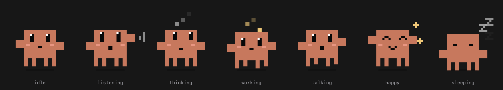

# Trixie

A little pixel pet that lives on your Mac desktop. Say **"hey Trixie"** (or hold a hotkey), ask her something, and she listens, thinks and answers out loud. Native Swift, no web, built on the `claude` CLI so it runs on your own Claude subscription.



## What she does

- **Always listening, on your Mac only.** Say "hey Trixie, …" and she wakes up. Speech recognition runs on-device, and nothing leaves your laptop until she's addressed. Or hold **Option + Space** to talk instead.
- **Real conversations.** After she answers she keeps listening for a few seconds, so you can just reply without saying her name again. Say "thanks", "that's all" or "bye" to end it (that costs no question), or stay quiet and she goes back to waiting for "hey Trixie".
- **A pet with moods.** She pops in with a hop, perks up and listens, looks up while thinking, "types" while reading your files, moves her mouth while talking, and falls asleep when you leave her alone. Her eyes follow your cursor, and clicks pass through everything except the creature itself.
- **Natural, streaming speech.** She says a short line before she goes off to read files, then speaks the answer sentence by sentence as it arrives. Choose a cloud voice ([ElevenLabs](https://elevenlabs.io)) or a free local one ([Kokoro](https://github.com/thewh1teagle/kokoro-onnx)). If the cloud voice fails or hits your monthly cap, she falls back to the local one automatically.
- **Careful by default.** She can only read and search files (`Read`, `Glob`, `Grep`), with a slim setup of about 5k tokens per question. Nothing that changes your machine yet.

## Requirements

- macOS 14 or later, Apple silicon recommended
- Swift 6 toolchain (the Xcode command-line tools are enough, no full Xcode needed)
- The [`claude` CLI](https://docs.claude.com/en/docs/claude-code), installed and logged in
- **Dictation turned on** in System Settings → Keyboard (Apple's on-device speech recogniser needs it)

## Run it

```
git clone https://github.com/YHQZ1/trixie.git
cd trixie
./scripts/run.sh
```

This builds `build/Trixie.app`, starts it and shows its log. macOS will ask for microphone and speech-recognition permission the first time. She must run as an app (not the bare binary) so those permissions work.

A text-only version, handy for testing: `swift run trixie-talk`.

## Voices

Without any setup she uses the built-in macOS voice. For something natural:

**Local (free, offline): Kokoro**

```
cd tts
uv venv .venv --python 3.12
uv pip install --python .venv/bin/python kokoro-onnx soundfile numpy
curl -L -o kokoro-v1.0.onnx https://github.com/thewh1teagle/kokoro-onnx/releases/download/model-files-v1.0/kokoro-v1.0.onnx
curl -L -o voices-v1.0.bin   https://github.com/thewh1teagle/kokoro-onnx/releases/download/model-files-v1.0/voices-v1.0.bin
```

Pick a voice with `CLAUDE_KOKORO_VOICE` (try `af_heart`, `af_nova`, `bf_emma`; audition them with `tts/audition.py`).

**Cloud: ElevenLabs**

1. Create an API key (Text to Speech access is enough) and store it in your Keychain, never in a file:
   `security add-generic-password -a "$USER" -s elevenlabs-api-key -w`
2. Pick a voice: `tts/.venv/bin/python tts/eleven_tool.py --use <voice name>`
3. Tune `tts/voice.json` (model, stability, `monthly_character_cap`).

Every reply's text is sent to ElevenLabs when this is on. The monthly cap keeps you inside a free plan; past it, she switches to the local voice.

## Settings

| Variable | What it does |
|---|---|
| `CLAUDE_HOTKEY` | Hold-to-talk shortcut, default `option+space` |
| `CLAUDE_LANG` | Speech recognition language, default `en-IN` (try `en-US`) |
| `CLAUDE_KOKORO_VOICE`, `CLAUDE_KOKORO_SPEED` | Local voice and speed |
| `CLAUDE_ENGINE=say` | Force the macOS voice |
| `CLAUDE_CWD` | Folder Claude may read, default `~/Developer` |
| `CLAUDE_MUTE=1` | Print only, don't speak |
| `CLAUDE_FOLLOWUP_SECONDS` | How long she keeps listening for a reply after answering, default `8` (`0` turns follow-ups off) |

The menu-bar icon has a switch for the always-on "hey Trixie" listening, and "Quit".

## How it works

- `ClaudeKit/ClaudeSession` runs `claude -p` with streaming JSON and `--resume` for memory.
- `ClaudeKit/WakeListener` listens for the wake phrase on-device and gathers your question.
- `ClaudeKit/VoiceListener` and `HotKey` handle push-to-talk.
- `ClaudeKit/SpeechText` turns the stream into speakable sentences.
- `tts/server.py` is the voice helper: ElevenLabs or Kokoro, sentence stitching, pronunciation fixes, a spending cap and automatic fallback.
- `Sources/trixie` is the app: the pixel pet (SwiftUI Canvas), its window and the menu bar.

`trixie --preview out.png` renders every mood to an image.

## Status

Working: wake word, push-to-talk, spoken answers, the pet, cloud and local voices. Next: letting her do things (music, Mac control, calendar), each behind a spoken confirmation.

## Notes

This is an unofficial hobby project. It is not affiliated with or endorsed by Anthropic or ElevenLabs. "Claude" is a trademark of Anthropic. It only drives the official `claude` CLI that you have installed and signed in to yourself.

Voices by [Kokoro](https://github.com/hexgrad/kokoro) (via [kokoro-onnx](https://github.com/thewh1teagle/kokoro-onnx)) and [ElevenLabs](https://elevenlabs.io).
